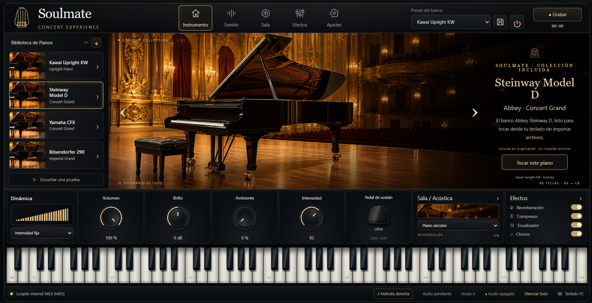

# Soulmate · Piano MIDI para Windows

[](https://github.com/horzioncode777/soulmate-piano/actions/workflows/check.yml)

Aplicación de escritorio que convierte un teclado MIDI en un piano virtual. Integra síntesis de audio, biblioteca local de instrumentos, efectos y grabación WAV en una interfaz de 88 teclas.

[Portafolio del autor](https://portafolio-jt.vercel.app/proyectos#piano) · [Publicaciones](https://github.com/horzioncode777/soulmate-piano/releases) · [Historial](docs/HISTORIAL.md)



La captura muestra la colección personal completa. La publicación del código incluye la preparación del Kawai Upright KW; los demás bancos de terceros se añaden por separado según sus licencias.

## Funcionalidades

- Entrada y monitor MIDI, selección de dispositivos, transposición y pedal CC64.
- Teclado de 88 teclas, controles por ratón y teclado del PC, y prueba musical sin dispositivo MIDI.
- Biblioteca persistente para importar, nombrar y gestionar bancos SF2/SF3/DLS.
- Volumen, brillo, reverberación, compresor, ecualización, chorus y realce de melodía derecha.
- Grabación del audio final en WAV estéreo PCM de 16 bits, con reintento de guardado.
- Ajustes persistentes y modo portátil con datos y grabaciones en rutas relativas.
- Instalador NSIS para Windows de 64 bits.

Desarrollado por **Juan Esteban Torres Delgado**. El trabajo integra la interfaz, entrada MIDI, biblioteca, ajustes, grabación, empaquetado y adaptaciones del pedal sobre SpessaSynth. Los bancos de sonido y las dependencias tienen sus propios autores y licencias.

## Ejecutar desde el código

Requisitos: Windows 10/11 de 64 bits, Node.js 22.x, npm y Git. Para tocar físicamente necesitas un teclado o interfaz MIDI compatible con Windows. También puedes usar el teclado del PC.

```powershell
git clone https://github.com/horzioncode777/soulmate-piano.git
cd soulmate-piano
npm ci
npm run setup:piano
npm run build:audio
npm start
```

`setup:piano` descarga el Kawai Upright KW desde Releases y verifica su SHA-256. Las dependencias y ese banco se descargan durante la preparación; después el piano funciona sin conexión. Los otros tres bancos de la colección personal no se redistribuyen. Consulta [la guía de bancos](docs/BANCOS.md).

Conecta el teclado, abre **Ajustes → Buscar dispositivos** y selecciona **Entrada MIDI**. Activa el piano con el botón de encendido o **Tocar este piano**. Usa **Escuchar una prueba** para comprobar la salida sin conectar un teclado. MIDI transmite notas; el audio sale por el PC.

## Comprobar y construir

```powershell
npm test
npm run check
npm run build:audio
npm run pack:dir
npm run pack
```

| Comando | Resultado |
| --- | --- |
| `npm test` | Pruebas de MIDI, biblioteca, ajustes, modo portátil y grabación WAV |
| `npm run check` | Sintaxis JavaScript y recursos necesarios |
| `npm run build:audio` | Reconstruye el AudioWorklet desde las dependencias fijadas |
| `npm run pack:dir` | Aplicación desempaquetada en `release/win-unpacked/` |
| `npm run pack` | Instalador `release/Soulmate-Setup-0.6.1.exe` |
| `npm run test:recording` | Prueba de escritorio de grabación con perfil aislado |
| `npm run test:library` | Prueba de biblioteca; requiere un banco de importación de prueba |
| `npm run test:collection` | Comprueba cobertura de los cuatro bancos personales, si están instalados |

GitHub Actions comprueba las pruebas, sintaxis, worklet y empaquetado en Windows. Las pruebas MIDI y de grabación no sustituyen la comprobación con un teclado físico. Las pruebas avanzadas de `tests/` documentan sus recursos adicionales en [BANCOS.md](docs/BANCOS.md).

El instalador público se prepara con el Kawai CC0. Los bancos opcionales están excluidos del empaquetado aunque existan en el equipo del desarrollador. El instalador no está firmado digitalmente; Windows puede identificar al editor como desconocido.

## Estructura y mantenimiento

```text
src/                    Interfaz, MIDI, controles y grabación
desktop/                Ventana Electron, permisos, servidor local y almacenamiento
assets/                 Escenario, iconos, worklet y licencias
assets/banks/           Bancos locales; las muestras se excluyen de Git
scripts/                Preparación, verificación, conversiones y empaquetado
tests/                  Pruebas unitarias y de escritorio
docs/                   Captura, bancos e historial
.github/workflows/      Comprobaciones automáticas
package-lock.json       Dependencias resueltas
```

Edita la interfaz en `src/index.html` y `src/style.css`; el comportamiento general en `src/app.js`; los mensajes MIDI en `src/midi.js`; y la grabación en `src/recorder.js` y `desktop/recording-store.cjs`. Los bancos integrados se describen en `src/builtins.js`. Los recursos generados, dependencias, perfiles de prueba e instaladores quedan fuera del historial.

El perfil instalado conserva `%APPDATA%/aurea-piano` por compatibilidad. El modo portátil se activa con `soulmate-portable.json` junto al ejecutable y usa las carpetas `Datos`, `Temporal` y `Grabaciones` relativas a la aplicación. No guardes perfiles personales ni grabaciones en GitHub.

## Alcance

Soulmate usa Electron, Web MIDI, Web Audio y SpessaSynth. El servidor de recursos escucha únicamente en `127.0.0.1`; la reproducción no envía notas a un servidor externo. No implementa ASIO, alojamiento de VST ni un controlador de puertos MIDI virtuales. La latencia indicada por Web Audio no mide el recorrido completo desde la tecla hasta el altavoz. El modo de dinámica experimental estima intensidad a partir del ritmo y no mide la fuerza real del dedo.

Las herramientas opcionales de conversión usan Python 3.12 con SoundFile para B290 o Pillow para regenerar iconos. No son necesarias para abrir, probar ni empaquetar la edición pública.

## Derechos de uso

El código original conserva todos los derechos reservados. Consulta [LICENSE](LICENSE). Los componentes y recursos de terceros conservan sus licencias; sus créditos, condiciones y exclusiones están en [THIRD_PARTY_NOTICES.md](THIRD_PARTY_NOTICES.md).
